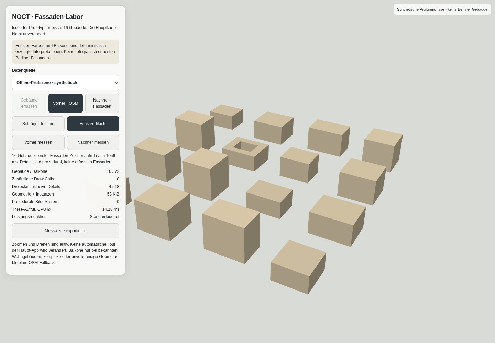
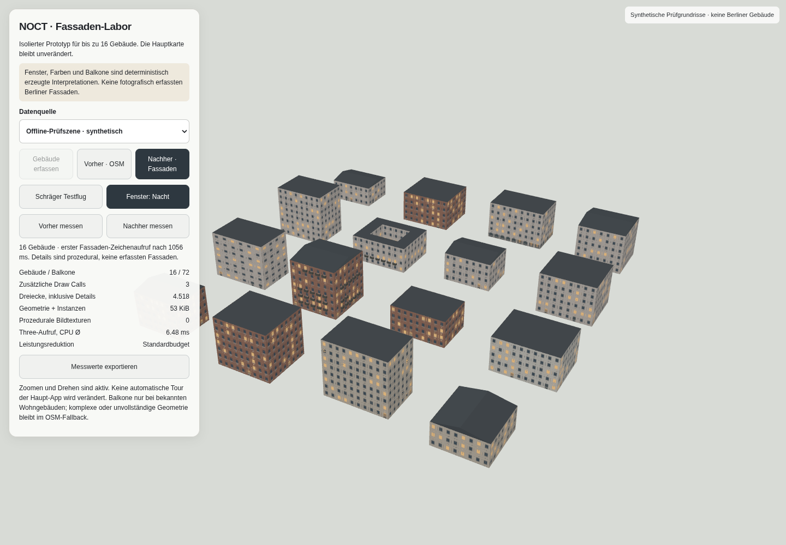

# Fassaden-Prototyp – überprüfter Vergleich

Historischer Vergleich des isolierten Prototyps. Die spätere Integration in die vollständige App ist separat dokumentiert: [Integrationsbericht](../facade-integration.md). Diese Screenshots sind kein Nachweis der Live-Berlin-Integration.

20.10.2026, Produktionsbuild von `feature/noct-3d`, isolierte Route `/prototypes/facades/?fixture=1`. **16 synthetische Prüfgebäude**, keine echten Berliner Gebäude und kein Live-Luftbildnachweis. Beide Darstellungen verwenden dieselben Grundrisse, Höhen und dieselbe Kameraposition.

| Vorher: bisherige Extrusionsregeln | Nachher: prozedurale Fassaden |
| --- | --- |
|  |  |

Weitere Nachweise: [schräge Perspektive nach Zoom und Drehung](desktop-oblique.png), [mobiler Touch-Viewport](mobile-after.png), [vollständige Messdaten und Checks](browser-results.json).

## Messverfahren

Chromium 151, Headless, ANGLE/SwiftShader **Software-Renderer** in der Cloud. Desktop 1.440 × 1.000, Geräte-DPR 1; mobiler Touch-Viewport 390 × 844, Geräte-DPR 3 und begrenztes Karten-DPR 1,5. Kein physisches iPhone, kein Safari-/Metal-Benchmark. Gerätebudget wurde anhand der Browsermerkmale gewählt.

Pro Darstellung ein identischer 5,2-Sekunden-Kameraschwenk von −40° nach 120°, Zoom 17,25, Pitch 60°, linearer Schwenk. Gemessen wurden die `render`-Ereignisabstände während aktiver Bewegung. Der Messdialog erfasst anschließend die Zähler; keine per-frame React-Zustandsänderung. Die Tests prüfen zusätzlich die tatsächliche Layer-Sichtbarkeit im Export: originale Extrusionen ausgeblendet; entweder Vergleichsextrusionen oder Fassaden aktiv, niemals beide Vergleichsdarstellungen zugleich.

| Messwert | Desktop vorher | Desktop nachher | Touch-Viewport vorher | Touch-Viewport nachher |
| --- | ---: | ---: | ---: | ---: |
| Render-Ereignisse/s | 7,37 | 6,44 | 11,93 | 9,06 |
| p95 Frame-Abstand | 275,1 ms | 371,8 ms | 172,4 ms | 212,0 ms |
| CPU für Three-Aufruf, Ø | entfällt | 0,56 ms | entfällt | 0,71 ms |
| JS-Heap, Momentaufnahme | 15,51 MiB | 19,57 MiB | 15,59 MiB | 12,44 MiB |

**Ergebnis:** Der Software-Renderer ist bereits bei der einfachen Baseline langsam. Zusätzliche Fassadendetails senken den beobachteten Render-Takt um ungefähr 13 % beziehungsweise 24 %. Das ist kein Nachweis einer Performanceverbesserung oder flüssiger iPhone-Nutzung. Der mobile Heap-Rückgang ist wegen Garbage Collection und Zeitpunkt der Stichprobe insbesondere **kein** Nachweis einer Speicheroptimierung.

Der separate Fassaden-Layer reserviert für diese Szene **53,48 KiB** Geometrie- und Instanzarrays; 4.518 Dreiecke einschließlich maximal 72 Balkonen, drei gemeinsam genutzte Geometrien und **keine Bildtexturen**. Normalerweise höchstens drei zusätzliche Draw Calls. Unter gemessener Last reduzierte die adaptive Logik die Balkondarstellung; am Messende waren es zwei Draw Calls. Die 53,48 KiB sind kein Gesamtspeicherwert für Three.js, MapLibre oder die GPU. GPU-Zeit, gesamter GPU-Speicher und reale Tile-Ladezeiten wurden nicht gemessen.

## Tatsächlich bestandene Prüfungen

- 16 Gebäude wurden im Browser gerendert; keine Shader-/JavaScript-Fehler im überprüften Lauf.
- Vorher/Nachher auf gleicher Kameraposition; ursprüngliche Extrusionen sind im begrenzten Vergleichsmodus ausgeblendet. Keine sichtbaren Doppelgeometrien in den endgültigen Screenshots.
- Tag-/Nachtumschaltung für Fenster.
- Drei rasche Testflug-Aufträge ersetzen jeweils die vorherige Bewegung; anschließend bleibt die Szene verfügbar.
- Zoom und Rechtsdrag-Drehung mit schrägem Blickwinkel.
- Touch-Viewport ohne horizontales Überlaufen, Buttons mindestens 44 CSS-Pixel hoch.
- Reduced Motion beim Einstieg und bei späterer Änderung der Systemeinstellung; animierte Messflüge deaktiviert.
- Absichtlich blockierte Kartendienste erzeugen einen Fehler und **null** behauptete Live-Gebäude.
- Neuladen rekonstruiert die Szene; Determinismus wird zusätzlich im Unit-Test geprüft.
- Erzwungener WebGL-Kontextverlust und Wiederherstellung rekonstruiert den Prototyp ohne JavaScript-/Shader-Fehler.
- `npm test`: **74 Tests bestanden**, einschließlich acht neuer Fassadentests.
- `npm run typecheck`: bestanden.
- `npm run build`: bestanden; die neue Route ist im bestehenden statischen Export enthalten.

Beim ersten Vergleich wurde ein realer Übergangsfehler entdeckt: Asynchrones Umschreiben des Sourcefilters ließ kurzzeitig alte Extrusions-Buckets unter den neuen Fassaden stehen. Der endgültige Prototyp verwendet zwei vorbereitete Vergleichsschichten und unmittelbare Sichtbarkeitswechsel statt eines neuen Sourcefilters pro Umschaltung.

## Noch nicht nachgewiesen

Der direkte OpenFreeMap-Zugriff der Cloudumgebung wurde mit `CONNECT 403` abgewiesen. Deshalb sind korrekte Positionierung und Darstellung **echter geladener Berliner Footprints** in diesem Lauf nicht visuell belegt; die geografische Matrix ist separat numerisch getestet. Live-Bauhöhen und Nutzungs-/Dachtags hängen vom vorhandenen Tile-Schema ab. Die Prüfszene enthält diese Tags absichtlich, um auch bedingte Balkone und Satteldächer zu testen.

Eine zuverlässige Aussage über Safari/iPhone-FPS, akkumulierten GPU-Speicher, authentische Fassaden, stadtweite Skalierung oder die vollständige automatische NOCT-Tour mit diesem Layer erfordert weitere Freigabe und Tests. Die produktive Tour wurde nicht mit dem Prototyp verbunden und nicht verändert. Die Empfehlung zur nächsten Stufe steht im [technischen Bericht](../procedural-facades.md).
